# SCHEME1 Architecture

**Status:** Stage 2 proposal. The contracts in `src/scheme1/contracts.py` are implemented and tested. The other modules are not built yet.

**Hard rule:** simulation only. There is no exchange-credential setting, no order-submission adapter and no withdrawal code anywhere in the system. Market data comes from public endpoints only.

## 1. Data flow

```mermaid
flowchart LR
  P["Provider adapter<br/>(GeckoTerminal / fixture)"] -->|CandleBatch + Provenance| RAW[("raw_candles")]
  RAW --> V["Validator"]
  V -->|ValidationReport + clean candles| CLEAN[("clean_candles")]
  CLEAN --> F["Feature engine"]
  F -->|FeatureSnapshot| A["Research agents<br/>(deterministic first, LLM optional)"]
  A -->|AgentOutput x N| D["Decision engine"]
  D -->|Decision| AUTH["Order authorizer<br/>(strategy sizing)"]
  AUTH -->|OrderIntent| R["Risk engine"]
  R -->|RiskVerdict| X{"approved?"}
  X -- no --> J[("audit log")]
  X -- yes --> B["Paper broker"]
  B -->|Order, Fill| ACC["Portfolio accounting"]
  ACC -->|PortfolioSnapshot| J
  J --> API["HTTP API"] --> UI["Dashboard"]
```

The **backtest** runs the same Validator → Features → Agents → Decision → Risk → Broker → Accounting chain. A chronological clock feeds it one closed candle at a time from stored history. Live paper trading feeds it the newest closed candle. Both paths share the same code, so a backtest result and a paper result mean the same thing.

## 2. Modules and contracts

| Module | Input | Output | Failure states |
| --- | --- | --- | --- |
| `data.providers` | symbol, interval, time range | `CandleBatch` (raw, with `Provenance`: provider, kind, retrieved_at, request, sha256) | timeout, rate limit (bounded retries with backoff), empty, `UNAVAILABLE` |
| `data.validate` | `CandleBatch` | `ValidationReport` + clean candles | `DEGRADED` (gaps, outliers), `STALE` (too old), `UNAVAILABLE` |
| `features` | clean candles up to time *t* | `FeatureSnapshot` (`as_of` = close of last candle used) | values `None` during warm-up or on zero denominators; `warmup_complete=false` |
| `agents` | `FeatureSnapshot` + `ValidationReport` | `AgentOutput` (stance, score, cited `Evidence`) | `UNAVAILABLE` (provider down), `INVALID` (schema or citation check failed) |
| `decision` | snapshot + agent outputs | `Decision` (research only, authorizes nothing) | non-OK data forces `HOLD` (enforced in the contract) |
| `authorize` | `Decision` + portfolio | `OrderIntent` or nothing | no intent for HOLD or when sizing rounds to zero |
| `risk` | `OrderIntent` + portfolio + desk state + data status | `RiskVerdict` with every check listed | always produces a verdict; any failed check rejects |
| `broker` | approved `OrderIntent`, later candles | `Order` status changes, `Fill`s | `REJECTED`, `EXPIRED`, `CANCELED` |
| `accounting` | fills, marks | `PortfolioSnapshot` | invariant violation raises and halts the desk (`EMERGENCY_STOP`) |
| `storage` | every record above | SQLite rows + hash-chained audit log | transaction rollback; startup integrity check |
| `backtest` | dataset id, config, period | run record, trades, equity curve, metrics | `insufficient_sample` reported, never a made-up number |
| `api` | HTTP | JSON from persisted records only | 503 with reason when a dependency is down |
| `ui` | API | pages | explicit empty / stale / loading / error states |

Every record carries versions: `SCHEMA_VERSION`, `feature_set_version`, `strategy_version`, `model_version`, `risk_config_version`, plus a hash of the run config.

## 3. Timing and fill rules (no look-ahead)

- Only **closed** candles enter the pipeline. An incomplete candle is stored as raw data but never validated or used for features.
- A decision made from candle *t* has `as_of = close_time(t)`. Its order can first trade in candle *t+1*.
- **Market order:** reference price is the **open of *t+1***. Fill price = open × (1 + slippage) for buys and × (1 − slippage) for sells. Taker fee applies.
- **Limit buy:** fills in the first candle *k > t* whose low is **strictly below** the limit (touching the limit is not enough). Fill price = min(limit, open_k), so a gap down fills at the open. Maker fee, no slippage. Limit sells mirror this.
- **Partial fills:** each candle can fill at most `participation_rate × candle volume` (default 5%). The remainder rests until filled, canceled or expired after `ttl_candles`.
- **No liquidity data** (zero volume): nothing fills in that candle.
- **Spot, long-only** in v1. SELL closes or reduces a long. It can never go short, and the risk engine rejects any sell larger than the position.

## 4. Risk engine

It runs outside any agent and reads its limits from a versioned config that agents cannot write. All checks run and all results are stored, including passes.

| Check | Rejects when |
| --- | --- |
| `desk_state` | desk is `DEGRADED`, `PAUSED` or `EMERGENCY_STOP` (no new entries) |
| `data_quality` | `ValidationReport.status` is not `OK` |
| `data_age` | newest closed candle is older than `max_data_age` |
| `cash` | buy cost + fee + slippage buffer exceeds available virtual cash |
| `position_size` | resulting position exceeds `max_position_pct` of equity |
| `gross_exposure` | total exposure exceeds `max_gross_exposure_pct` |
| `concentration` | one asset exceeds `max_asset_pct` |
| `correlated_exposure` | exposure to assets with rolling correlation > `corr_threshold` exceeds `max_correlated_pct` |
| `drawdown` | equity drawdown from peak exceeds `max_drawdown_pct` (also flips the desk to `PAUSED`) |
| `frequency` | more than `max_orders_per_day`, or within `cooldown_candles` of the last order on the symbol |
| `duplicate_or_conflict` | an open order exists on the same symbol, or the intent opposes an open order |
| `short_sale` | a sell exceeds the held quantity |

Desk states: `NORMAL` → `DEGRADED` (automatic on data problems; clears when data recovers) → `PAUSED` (operator or drawdown; cleared by operator) → `EMERGENCY_STOP` (kill switch: cancels all open orders, needs a manual reset).

## 5. Confidence

`Decision.confidence.kind` is `uncalibrated_research_score` until a calibration run exists. That run is a chronological out-of-sample evaluation with reliability bins and a Brier score, stored with an id. Only then may a strategy version emit `calibrated_probability`, which must cite that run (enforced in the contract). An LLM's self-reported confidence is never used as this value.

## 6. Agents

- Phase 1: **deterministic** agents (market, technical, data-quality, bull, bear, risk, manager). Each one reads only the `FeatureSnapshot` and `ValidationReport`, and every `fact` must cite a feature key. The contract enforces that.
- Phase 2: optional LLM adapter behind the same `AgentOutput` contract. Its output is JSON-schema validated, and numbers it quotes are checked against the snapshot (a mismatch marks the output `INVALID`). If the provider is down, the deterministic path still runs. Token usage and cost are logged.
- The decision engine never counts votes as proof. The manager weighs evidence by role, and disagreement lowers confidence instead of being forced into consensus.

## 7. Storage and recovery

- SQLite in WAL mode (stdlib, no server). Each pipeline step for one candle commits in **one transaction**.
- `audit_log` is append-only. Each row stores `sha256(prev_hash + payload)`, so editing any past row breaks the chain, and startup verifies it.
- On restart, positions and cash are **rebuilt from the fill history** and compared to the last stored snapshot. A mismatch flips the desk to `EMERGENCY_STOP` instead of trading on bad books.
- Backup: `sqlite3 desk.db ".backup backup.db"` while running (safe with WAL).

## 8. Stack

Python ≥3.11. Libraries: pydantic (contracts), Python stdlib HTTP for the GeckoTerminal public API (see D10; ccxt dropped for now), FastAPI + uvicorn (API), pytest. Frontend: static HTML/CSS/JS served by the API, with no build step. No Postgres, Redis or Docker needed.
